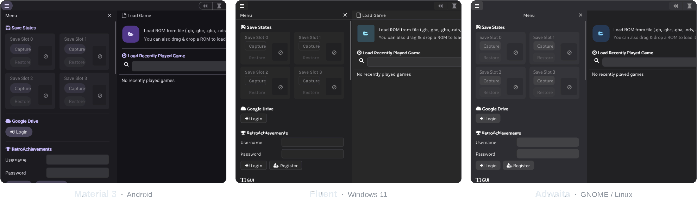
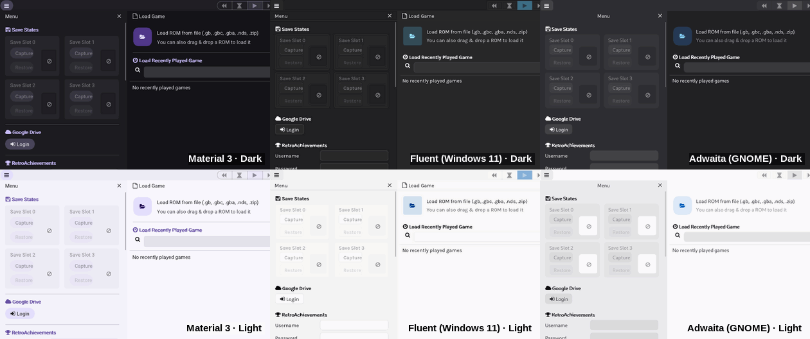
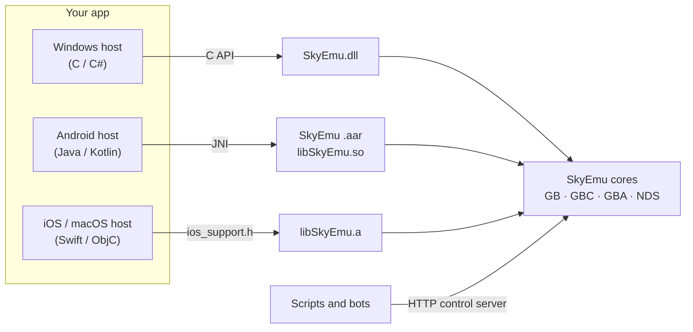

<div align="center">


# SkyEmu OMEGA

**A low-level Game Boy, Game Boy Color, Game Boy Advance and Nintendo DS emulator<br>that looks native on every platform and embeds into your own apps.**

[](LICENSE)
[](https://github.com/skylersaleh/SkyEmu)
[](#-platforms)

[](https://github.com/Pierreg99/SkyEmu-OMEGA-FORK/actions/workflows/deploy_linux.yml)
[](https://github.com/Pierreg99/SkyEmu-OMEGA-FORK/actions/workflows/deploy_win.yml)
[](https://github.com/Pierreg99/SkyEmu-OMEGA-FORK/actions/workflows/deploy_mac.yml)
[](https://github.com/Pierreg99/SkyEmu-OMEGA-FORK/actions/workflows/deploy_android.yml)
[](https://github.com/Pierreg99/SkyEmu-OMEGA-FORK/actions/workflows/deploy_ios.yml)
[](https://github.com/Pierreg99/SkyEmu-OMEGA-FORK/actions/workflows/deploy_web.yml)

<a href="https://github.com/Pierreg99/SkyEmu-OMEGA-FORK/actions/workflows/deploy_android.yml"></a>
<a href="https://github.com/Pierreg99/SkyEmu-OMEGA-FORK/actions"></a>

[**Get started**](#-get-started) · [**Build**](docs/BUILDING.md) · [**Embed**](docs/EMBEDDING.md) · [**Design systems**](docs/DESIGN_SYSTEMS.md) · [**All docs**](docs/README.md)

</div>

<br>

<picture>
  <source media="(prefers-color-scheme: dark)" srcset="docs/images/hero-dark.png">
  <source media="(prefers-color-scheme: light)" srcset="docs/images/hero-light.png">
  
</picture>

<p align="center"><sub>The same emulator in Material 3, Fluent and Adwaita. Light or dark mode and the accent color come from your system.</sub></p>

> [!NOTE]
> SkyEmu OMEGA is a fork of [SkyEmu](https://github.com/skylersaleh/SkyEmu) by Skyler "Sky" Saleh. The emulation
> cores are SkyEmu's. This fork adds platform native design systems and turns SkyEmu into a component that other
> apps can host on Windows, Android and iOS.

> [!TIP]
> **Sol6.1 upgrade:** CRT scanline, aperture grille and soft LCD shaders; display color controls; high contrast
> and layout options; settings, file I/O and audio fixes; and modern Android, Linux and Windows builds.
> See [the upgrade notes and validation steps](docs/SOL6_1_UPGRADE.md).

<p align="center">
<a href="#-highlights">Highlights</a> ·
<a href="#-what-omega-adds">What OMEGA adds</a> ·
<a href="#-platforms">Platforms</a> ·
<a href="#-get-started">Get started</a> ·
<a href="#-controls">Controls</a> ·
<a href="#-accuracy">Accuracy</a> ·
<a href="#-documentation">Documentation</a> ·
<a href="#-credits-and-license">Credits</a>
</p>

## ✨ Highlights

<table>
<tr>
<td width="33%" valign="top">

### 🎮 Accurate cores
- Game Boy Advance with a per-pixel PPU, full pipeline and prefetch emulation
- Game Boy and Game Boy Color
- Nintendo DS (beta)
- Real time clock and solar sensor
- Works without BIOS files thanks to open source replacements

</td>
<td width="33%" valign="top">

### 🎨 Native look
- Material 3 / Material You on Android
- Fluent on Windows 11
- Adwaita on GNOME / Linux
- Light, dark and AMOLED black, following the system
- System accent colors and UI fonts
- The original SkyEmu skin and custom skins stay available

</td>
<td width="33%" valign="top">

### 🧩 Built to be embedded
- Windows DLL with a C API
- Android library with a JNI API
- iOS and macOS static libraries
- Framebuffer access and input injection
- REST-like HTTP control server for scripts and bots

</td>
</tr>
<tr>
<td valign="top">

### ⏪ Play your way
- Fast forward, slow motion and very long rewind
- 4 save state slots with screenshot previews
- Action Replay cheat engine
- Game controllers with rumble and rebindable keys

</td>
<td valign="top">

### 🖥️ Great picture
- LCD, subpixel and xBRZ upscaling shaders
- GBA color correction (SkyEmu or Higan)
- Screen ghosting
- Flexible DS screen layouts

</td>
<td valign="top">

### 🧰 For tinkerers
- CPU, MMIO and memory debuggers
- RetroAchievements with hardcore mode
- Google Drive save state sync
- ROMs inside `.zip` archives
- Translated into 13 languages

</td>
</tr>
</table>

## 🌟 What OMEGA adds

| | Upstream SkyEmu | SkyEmu OMEGA |
|---|---|---|
| **GUI** | One image based skin (dark, light, black, custom) | Material 3, Fluent and Adwaita, chosen per platform, plus the original skin |
| **System integration** | | Dark mode, accent color, UI font and window frame follow the OS |
| **Windows** | Stand-alone app | `SkyEmu.dll` with a C API ([`skyemu_dll.h`](src/skyemu_dll.h)) for host apps |
| **Android** | Stand-alone app | Android library with a JNI settings and control API |
| **iOS / macOS** | Stand-alone app | Static libraries for host apps (the macOS app bundle is still available) |
| **Host APIs** | HTTP control server | Framebuffer access, key injection, UI and menu callbacks, save state slots, every setting |

<details>
<summary><b>Every design in light and dark</b></summary>
<br>

</details>



The design systems are described in [docs/DESIGN_SYSTEMS.md](docs/DESIGN_SYSTEMS.md) and the host APIs in [docs/EMBEDDING.md](docs/EMBEDDING.md).

## 📦 Platforms

| Platform | Build output | Default design | Notes |
|---|---|---|---|
| **Windows** 10 / 11 | `SkyEmu.dll` | Fluent | Started by a host app through `win_main()` |
| **Linux** | `SkyEmu` executable | Adwaita | X11 or XWayland, ALSA audio |
| **FreeBSD** | `SkyEmu` executable | Adwaita | |
| **Android** 7.0+ | Installable APK, and `libSkyEmu.so` in an Android library | Material 3 | Material You colors on Android 12+ |
| **macOS** | `SkyEmu.app`, or a static library | SkyEmu Classic | |
| **iOS** 15+ | Static library | SkyEmu Classic | The host app provides `main()` and calls `main_ios()` |
| **Web** | WebAssembly progressive web app | Material 3 | Follows the browser's color scheme |
| **libretro** | `skyemu_libretro` core | Frontend UI | For RetroArch and other frontends |

## 🚀 Get started

### Download

Every push builds all platforms on GitHub Actions. Open a workflow run under
[**Actions**](https://github.com/Pierreg99/SkyEmu-OMEGA-FORK/actions) and download its artifact
(`LinuxRelease`, `WindowsRelease`, `AndroidRelease-APK`, ...).

### Install on Android

1. Open the latest green [**Build Android**](https://github.com/Pierreg99/SkyEmu-OMEGA-FORK/actions/workflows/deploy_android.yml)
   run and download **AndroidRelease-APK** (GitHub wraps it in a `.zip`; extract `apk-release.apk`).
2. Copy it to your phone and open it, allowing installs from that app when Android asks.
   Or, with USB debugging on: `adb install apk-release.apk`.
3. Launch **SkyEmu** and tap **Load Game**. One ~100 MB APK covers Android 7.0+ on ARM and x86 devices.

> [!NOTE]
> CI APKs are signed with a throwaway debug key, so Android may warn about an unknown developer and you
> cannot update over an install signed with another key. Build it yourself with
> `cd tools/android_project && ./gradlew :apk:assembleRelease`.

Stand-alone releases of upstream SkyEmu, including a version that runs in the browser, are at
[github.com/skylersaleh/SkyEmu/releases](https://github.com/skylersaleh/SkyEmu/releases) and
[web.skyemu.app](https://web.skyemu.app/).

### Build from source

```sh
git clone https://github.com/Pierreg99/SkyEmu-OMEGA-FORK.git
cd SkyEmu-OMEGA-FORK
cmake -B build -DCMAKE_BUILD_TYPE=Release
cmake --build build --parallel
./build/bin/SkyEmu path/to/game.gba
```

Dependencies and the steps for Windows, Android, iOS, macOS, the web and libretro are in
[docs/BUILDING.md](docs/BUILDING.md).

### Games, saves and BIOS files

- Open a ROM (`.gb`, `.gbc`, `.gba`, `.nds` or a `.zip` of one) from the **Load Game** screen, by drag and drop,
  or as the first command line argument.
- Save files use the ROM name with a `.sav` extension (`Game.gba` → `Game.sav`) and live next to the ROM.
  In the web version, drop them onto the page or load them with the file picker.
- BIOS files are optional. SkyEmu ships open source replacements, but official dumps are more accurate and
  enable features such as the Game Boy Color colorization and boot animations. The GBA BIOS must be named
  `gba_bios.bin`.

> [!TIP]
> Change the look in **Menu → GUI → Design**: *Platform Native*, *Material 3*, *Fluent (Windows 11)*,
> *Adwaita (GNOME)* or *SkyEmu Classic*. Color scheme, accent color and font are right below it.

## 🎹 Controls

Every binding can be changed in **Menu → Keybinds**, and game controllers are mapped automatically.

| Console | Key | | Emulator | Key |
|---|---|---|---|---|
| D-Pad | <kbd>W</kbd> <kbd>A</kbd> <kbd>S</kbd> <kbd>D</kbd> | | Pause / play | <kbd>Space</kbd> |
| A / B | <kbd>J</kbd> / <kbd>K</kbd> | | Rewind | <kbd>R</kbd> |
| X / Y (DS) | <kbd>N</kbd> / <kbd>M</kbd> | | Fast forward 2× / max | <kbd>F</kbd> / <kbd>Tab</kbd> |
| L / R | <kbd>U</kbd> / <kbd>I</kbd> | | Save state 1–4 | <kbd>1</kbd> … <kbd>4</kbd> |
| Start / Select | <kbd>Enter</kbd> / <kbd>'</kbd> | | Load state 1–4 | <kbd>F1</kbd> … <kbd>F4</kbd> |
| Fold screen (DS) | <kbd>B</kbd> | | Solar sensor − / + | <kbd>-</kbd> / <kbd>=</kbd> |
| Tap screen (DS) | <kbd>V</kbd> | | Full screen | <kbd>F11</kbd> |

## 🎯 Accuracy

SkyEmu has been tested on hundreds of ROMs. Most games are playable with no or minor bugs, and the GBA core is
more accurate than the GB/GBC core.

<details>
<summary><b>Game Boy Advance</b></summary>

- Per-pixel PPU that handles scanline and mid-scanline effects
- Passes the AGS Aging test cartridge
- Runs hard to emulate games such as the Classic NES Series, Golden Sun and Hello Kitty Miracle Fashion Maker
- Passes all ArmWrestler, FuzzARM, `arm.gba` and `thumb.gba` tests
- Passes 2020/2020 GBA Suite timing tests with the official BIOS
- Full instruction pipeline and prefetch emulation

</details>

<details>
<summary><b>Game Boy / Game Boy Color</b></summary>

- Passes all of Blargg's CPU instruction tests
- Passes the DMG and CGB acid2 PPU tests and MBCtest
- Dot clock based PPU
- Anti-aliased audio synthesis with per-sample APU changes (Pikachu's voice in Pokémon Yellow works)

</details>

The comparison with other emulators is in [docs/Accuracy.md](docs/Accuracy.md).

## 📚 Documentation

| Page | What is inside |
|---|---|
| [Building](docs/BUILDING.md) | Dependencies and build steps for every platform |
| [Embedding](docs/EMBEDDING.md) | Hosting SkyEmu from a Windows, Android or iOS app |
| [Design systems](docs/DESIGN_SYSTEMS.md) | Material 3, Fluent, Adwaita and how they follow the OS |
| [HTTP control server](docs/HTTP_CONTROL_SERVER.md) | Scripting and automation over HTTP |
| [Custom themes](docs/CUSTOM_THEMES.md) | Making image skins for the classic design |
| [Accuracy](docs/Accuracy.md) | Test ROM and game compatibility comparison |
| [Library modifications](docs/LibraryModifications.md) | Changes made to bundled third-party code |

## 🙏 Credits and license

SkyEmu is created by [Skyler "Sky" Saleh](https://github.com/skylersaleh) and
[its contributors](https://github.com/skylersaleh/SkyEmu/graphs/contributors). The Windows DLL, Android library
and iOS static library work comes from [toanlcgift](https://github.com/toanlcgift). The people and projects
that made the emulation possible are thanked in [ACKNOWLEDGMENTS.md](ACKNOWLEDGMENTS.md).

Questions about the emulator itself are welcome in the upstream
[SkyEmu Discord](https://discord.gg/tnUEtmJgA5).

<details>
<summary><b>Birds of a feather</b>: related projects</summary>

- [**Pokemon Bot**](https://github.com/OFFTKP/pokemon-bot): a Discord bot that connects to SkyEmu so your server can play GB/GBC/GBA/NDS games together
- [**Panda3DS**](https://github.com/wheremyfoodat/Panda3DS): a panda themed HLE 3DS emulator
- [**NanoBoyAdvance**](https://github.com/nba-emu/NanoBoyAdvance): a cycle-accurate GBA emulator focused on hardware research
- [**Dust**](https://github.com/kelpsyberry/dust): a DS emulator for desktop and the web
- [**Kaizen**](https://github.com/SimoneN64/Kaizen): an experimental low-level N64 emulator

</details>

SkyEmu OMEGA is released under the [MIT License](LICENSE). Game Boy, Game Boy Color, Game Boy Advance and
Nintendo DS are trademarks of Nintendo. This project is not affiliated with Nintendo.
